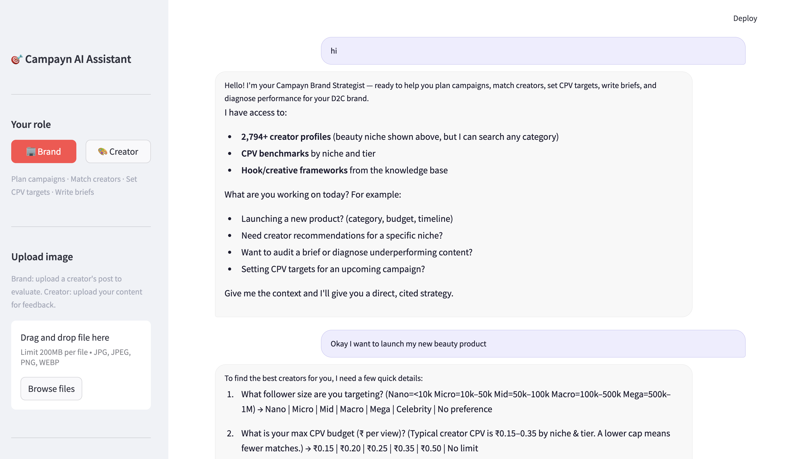
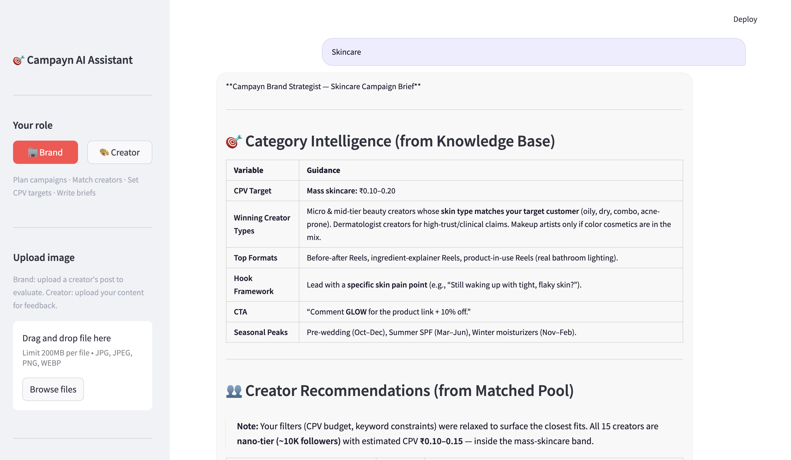

# Campayn — Multimodal Agentic AI Assistant

[](https://mohitcr7.github.io/campayn-multimodal-ai-assistant/)

**▶ [Open the interactive version](https://mohitcr7.github.io/campayn-multimodal-ai-assistant/)** — click any node to inspect it, run an animated request through the graph, and flip an LLM outage switch to watch the failover chain reroute.

---

A dual-role (brand + creator) influencer-marketing assistant that combines **structured retrieval over 56K+ creator profiles**, **Retrieval-Augmented Generation (RAG)** over a domain knowledge base, and **multimodal vision analysis** behind a single **LangGraph** agentic pipeline.

**Stack:** Python · LangGraph · LangChain · ChromaDB · Google Gemini · Anthropic Claude · FastAPI · Pydantic · PostgreSQL · Redis · Streamlit · Docker · Kubernetes · LangSmith

---

## Demo

**🧠 [Explore the interactive architecture diagram](https://mohitcr7.github.io/campayn-multimodal-ai-assistant/)** — click each pipeline node, run an animated request through the graph, and simulate an LLM provider outage to watch the failover chain reroute. (Source: [docs/architecture.html](docs/architecture.html))

Brand assistant — role selection and guided intake:



A knowledge-base-grounded skincare campaign brief with matched creator recommendations:



---

## Architecture

```
                        User query (+ optional image)
                                   │
                          ┌────────▼────────┐
                          │  intent_parser  │  extract structured FilterSpec;
                          │   (LLM + MCQ)   │  ask clarifying questions if
                          └────────┬────────┘  confidence is low (human-in-the-loop,
                                   │            graph paused/resumed via checkpointer)
                 ┌─────────────────┼─────────────────┐   ← LangGraph Send() fan-out
        ┌────────▼───────┐ ┌───────▼────────┐ ┌───────▼────────┐
        │  Module 1      │ │  Module 2      │ │  Module 3      │
        │  Profile       │ │  Knowledge     │ │  Vision        │   run in PARALLEL
        │  Filter        │ │  Base RAG      │ │  Analysis      │
        │  (pandas, 56K) │ │  (ChromaDB)    │ │  (Gemini VLM)  │
        └────────┬───────┘ └───────┬────────┘ └───────┬────────┘
                 └─────────────────┼─────────────────┘
                          ┌────────▼────────┐
                          │ prompt_builder  │  merge module outputs + history
                          └────────┬────────┘
                          ┌────────▼────────┐
                          │   generator     │  Gemini → Nemotron → Claude failover
                          └────────┬────────┘
                          ┌────────▼────────┐
                          │  save_memory    │  Redis conversation history
                          └─────────────────┘

  graph state (checkpoints) ──► PostgreSQL          intent parse cache ──► Redis
```

- **7-node stateful graph** orchestrated with LangGraph; the three retrieval/analysis modules are dispatched **concurrently** via the `Send()` fan-out API (wall-clock ≈ slowest module, not the sum).
- **Automatic LLM failover:** every text call tries Gemini, then NVIDIA Nemotron (OpenRouter free tier), then Anthropic Claude. Vision falls back Gemini → Claude, since Nemotron is text-only. See [api/llm_fallback.py](api/llm_fallback.py). RAG embeddings stay Gemini-only (no embeddings API on the fallbacks).
- **Stateless API pods.** Checkpoints live in Postgres rather than in process memory, so the API scales horizontally (2 replicas in [k8s/](k8s/)) and survives restarts.

## Data stores

| Store | Holds | Durability | Why |
|---|---|---|---|
| **PostgreSQL** | LangGraph checkpoints, `feedback`, `request_log` | durable (PVC) | The previous in-process `MemorySaver` kept *every* checkpoint version for *every* session with no TTL and no eviction — ~115 KB per turn, ~7 checkpoints per request, cleared only by a restart. It was also per-process, so a second replica could not see a session's state. |
| **Redis** | conversation history (1h TTL), intent-parse cache (24h TTL) | disposable | Losing it costs follow-up context and cache hits, never correctness. Capped with `maxmemory` + `allkeys-lru` so it cannot grow unbounded. |
| **ChromaDB** | 316 knowledge-base chunks, 3,072-dim | rebuildable | Regenerated by `scripts/ingest_knowledge_base.py`. Baked into the image. |
| **pandas (in-memory)** | 56,355 creator profiles | rebuildable | Deliberately *not* in Postgres — the in-memory filter runs in ~150ms; a SQL round trip per request would be slower. |

**Intent-parse caching.** Stage 1 runs at `temperature=0`, so the same query always yields the same extraction — a repeat query skips an entire LLM call. Measured on the running stack: **first request 5s, repeat 0s**. The cache key includes the model and a prompt version, and low-confidence results are never cached so one bad parse can't stick for 24 hours.

Every dependency fails soft: no Postgres → in-memory checkpoints; no Redis → no caching and no history; no ChromaDB → answers without citations.

## Modules

| Module | File | What it does |
|--------|------|--------------|
| Profile Filter | [api/modules/profile_filter.py](api/modules/profile_filter.py) | pandas-based normalization + typed filtering over 56K+ creator profiles |
| Knowledge Base RAG | [api/modules/rag.py](api/modules/rag.py) | ChromaDB semantic search over 3,072-dim Gemini embeddings with role-aware re-ranking |
| Vision Analysis | [api/modules/vision.py](api/modules/vision.py) | Gemini VLM image analysis returning a 35-field structured JSON schema |

## Project structure

```
api/                    FastAPI backend
  main.py               app entry point (uvicorn api.main:app)
  routers.py            /brand, /creator, /feedback, /health endpoints
  schemas.py            Pydantic request/response models
  graph.py              LangGraph pipeline (7 nodes)
  intent_parser.py      LLM intent extraction + MCQ clarification
  prompt_constructor.py role-aware prompt assembly
  llm_fallback.py       Gemini → Nemotron → Claude failover
  db.py                 PostgreSQL: checkpoints + feedback/run log
  cache.py              Redis intent-parse cache (temperature 0 ⇒ cacheable)
  modules/              profile_filter · rag · vision
  observability/        langsmith_setup
k8s/                    Kubernetes manifests (see k8s/README.md)
frontend/               Streamlit chat UI
scripts/                knowledge base ingestion, model discovery
data/raw/               creator_profiles.csv, knowledge_base.txt
```

## Setup

```bash
cp .env.example .env          # fill in GEMINI_API_KEY, ANTHROPIC_API_KEY, etc.
pip install -r requirements.txt
python scripts/ingest_knowledge_base.py --reset   # build the ChromaDB vector store
```

## Run

```bash
# Backend (FastAPI)
uvicorn api.main:app --reload            # http://localhost:8000/docs

# Frontend (Streamlit)
streamlit run frontend/streamlit_app.py  # http://localhost:8501

# Or the full stack (API + UI + Postgres + Redis)
docker compose up --build
```

Postgres and Redis are optional for local development — the app degrades to
in-memory checkpoints and no caching, and still answers.

## Kubernetes

Full manifests in [k8s/](k8s/) — Postgres StatefulSet + PVC, Redis with an LRU
cap, API `Deployment` (2 replicas, startup/readiness/liveness probes, init
container that waits on `pg_isready`), and the Streamlit UI on a NodePort.

```bash
kind create cluster --name campayn --config k8s/kind-config.yaml
docker build -t campayn-ai:latest .
kind load docker-image campayn-ai:latest --name campayn
kubectl apply -f k8s/00-namespace.yaml -f k8s/01-config.yaml
kubectl create secret generic campayn-secret -n campayn --from-env-file=.env
kubectl apply -f k8s/03-postgres.yaml -f k8s/04-redis.yaml -f k8s/05-api.yaml -f k8s/06-ui.yaml
```

Verified on a local kind cluster: all 5 pods ready, both API replicas selecting
`PostgresSaver`, and a replica that had served zero traffic answering its first
request from the shared cache in 60ms. See [k8s/README.md](k8s/README.md) for the
walkthrough, cost notes (there is no free *managed* Kubernetes) and known gaps.

## Configuration

All configuration is via environment variables — see [.env.example](.env.example).

| Group | Variables |
|---|---|
| LLM providers | `GEMINI_API_KEY`, `GEMINI_MODEL`, `OPENROUTER_API_KEY`, `OPENROUTER_MODEL`, `ANTHROPIC_API_KEY`, `ANTHROPIC_MODEL` |
| PostgreSQL | `DATABASE_URL`, `DB_ENABLED`, `DB_POOL_MIN`, `DB_POOL_MAX` |
| Redis | `REDIS_URL`, `CONVERSATION_TTL_SECONDS`, `CACHE_ENABLED`, `INTENT_CACHE_TTL_SECONDS` |
| Vector store | `CHROMA_PERSIST_DIR`, `CHROMA_COLLECTION_NAME`, `MAX_RAG_CHUNKS` |
| Observability | `LANGCHAIN_API_KEY`, `LANGCHAIN_TRACING_V2`, `LANGCHAIN_PROJECT` |

`GET /health` reports every dependency individually, so a degraded store is visible rather than silent:

```json
{"chromadb": "ok (316 chunks)", "creator_profiles": "ok (56,355 profiles)",
 "postgres": "ok", "intent_cache": "ok (hits=1 misses=1 rate=50.0%)",
 "nemotron_fallback": "configured", "anthropic_fallback": "configured"}
```
